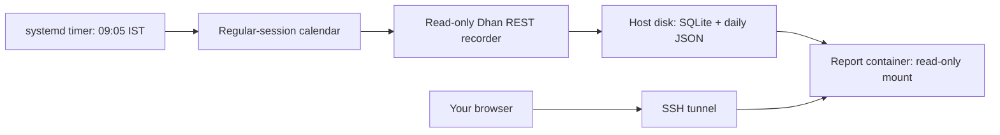

# Singapore Lightsail deployment

Deployed on 21 October 2026 (Singapore), following approval of the US$12/month instance. AWS profile `default`, instance `nse-recorder`, region `ap-southeast-1`. Local connection details are in `.local/deploy/ACCESS.md`; private keys and credentials are excluded from Git and deployment archives.

## Selected plan

| Setting | Value |
| --- | --- |
| Region / zone | `ap-southeast-1` / `ap-southeast-1a` |
| Instance name | `nse-recorder` |
| OS | `ubuntu_24_04` (Ubuntu 24.04 LTS) |
| Bundle | `small_3_0`: 2 CPUs, 2 GiB RAM, 60 GiB disk, IPv4 |
| AWS quoted bundle price | **US$12/month**, before tax and usage overages |
| Included transfer | 3,072 GiB/month (AWS regional accounting rules apply) |
| Additional resources | None initially: no load balancer, domain, public report endpoint or snapshot subscription |

Price/specifications came from the Lightsail API in the selected region. The instance is billed while stopped; deleting it removes its root disk. Dhan charges are separate. The user approved this paid plan before creation. A 1 GiB / 40 GiB bundle is US$7/month, but the 2 GiB plan gives more room for Docker builds and instrument-master parsing.

## Operation



The host stays on. The timer launches the worker at **09:05 IST / 11:35 Singapore**, Monday–Friday; collection finishes at 15:35 IST / 18:05 Singapore. The application checks a published regular-session calendar and skips holidays or launches outside that window. A persistent timer catches a missed start after reboot during the window. Worker failures restart after 60 seconds; SQLite deduplicates candles. Authentication failure ends the run with exit 2: renew credentials and restart manually. Completed sessions with upstream missing candles also exit 2 and retain their quality report.

The included calendar covers **21 October–31 December 2026**. Update it before 2027 and after exchange notices. Special sessions such as Muhurat trading are not supported by these regular-hours rules. Timestamp interpretation and calendar verification in strategy reports remain provisional; this deployment enables observation only, never orders or strategy signals.

## Package and provision

On the laptop:

```sh
deploy/lightsail/aws-plan.sh default ap-southeast-1
deploy/lightsail/package.sh
```

The archive is `.local/deploy/nse-assistant-lightsail.tar.gz`. Its explicit source allowlist excludes `.env.local`, AWS credentials, Git history and recorded data. Build and unit tests run before packaging.

After the paid proposal is approved, create the specified instance with a dedicated SSH key. Replace the default Lightsail firewall with **TCP 22 from your current public IP /32 only**, remove HTTP/HTTPS and IPv6 ingress rules, and confirm the resulting firewall before transferring credentials. No application port should be publicly reachable. Your IP may need updating when you travel; the AWS Lightsail console is the recovery path. No static IP is planned initially, so refresh the SSH target if the instance public IP changes.

Using the resulting host address and private key, upload/extract the archive into `/opt/nse-assistant`, then on the server:

```sh
cd /opt/nse-assistant
sudo bash deploy/lightsail/install.sh
sudoedit /etc/nse-assistant/dhan.env
```

Copy only `DHAN_CLIENT_ID` and `DHAN_ACCESS_TOKEN` from your local secret file into the server file. Keep `DHAN_CANDLE_START_VERIFIED=false`. Do not paste tokens into this chat, command arguments or shell history. The installer creates this root-owned file with mode 0600. AWS login credentials stay on your laptop; they are not required by the worker.

Verify the token through one read-only collection during a scheduled session, then enable:

```sh
sudo systemctl start nse-recorder.service
sudo journalctl -u nse-recorder.service -n 20 --no-pager
sudo systemctl enable --now nse-reports.service nse-recorder.timer
sudo systemctl list-timers nse-recorder.timer
```

Outside the collection window, starting the worker only records a skip decision. A successful skip does not establish valid Dhan authentication. Inspect report timestamps, instrument errors and missing slots during the next live session. Reboot once after setup and check both enabled services and retained data.

## Private reports and administration

On your laptop (replace `KEY_PATH` and `HOST` with the provisioned values):

```sh
ssh -i KEY_PATH -N -L 127.0.0.1:8787:127.0.0.1:8787 ubuntu@HOST
```

Open <http://127.0.0.1:8787>. The viewer refreshes every 30 seconds. It displays the latest report; an old report is not a health check. The report container receives no Dhan credentials and mounts data read-only. In an AWS console SSH session you can also read daily JSON with `sudo cat /var/lib/nse-recorder/YYYY-MM-DD.json`.

```sh
sudo journalctl -u nse-recorder.service --since today --no-pager
sudo systemctl status nse-recorder.timer nse-reports.service
sudo systemctl stop nse-recorder.timer nse-recorder.service  # pause collection
```

Dhan web access tokens last 24 hours. Renew the server token before it expires, preferably before each session; changing your laptop's `.env.local` does not update the server. After `sudoedit`, restart the recorder if today's run ended for authentication failure. No automatic token renewal or alerts are configured. A full-day unattended run requires a token valid through 15:35 IST.

## Storage and recovery

`/var/lib/nse-recorder` holds the SQLite database and daily JSON independently of containers and application releases. Restarting/rebuilding containers retains this directory. The lock uses temporary `/run/recorder` inside the container, so a crashed container cannot leave a persistent file lock. SQLite also records candle revisions and poll history.

Root-disk persistence is not a disaster backup. Before deleting/replacing the instance, stop the recorder and copy `/var/lib/nse-recorder` to a secure independent destination; stopping it first avoids copying a database mid-write. No automatic snapshots or off-host backups are included in the US$12 proposal. Monitor disk space and update the calendar. Reports have no public authentication layer because the service is loopback-only behind SSH.

## ChatGPT Cloud

ChatGPT Cloud can run coding and test tasks while the laptop sleeps, but its task environment is not documented as an always-on recorder host. Default VM state is recoverable for a limited period after last start/resume. Use Lightsail for the unattended worker; use ChatGPT Cloud for development and investigation. [Official Cloud environments documentation](https://learn.chatgpt.com/docs/environments/cloud-environments).

## Validation

All 42 local tests passed. The Docker image was built locally and on the x86_64 Ubuntu host. Synthetic restart tests retained nine unique candles per instrument. On AWS, authenticated REST retrieval for 19 October returned 72 candles per instrument with three missing final slots, matching the prior local observation. systemd validated the calendar expression and units; the enabled timer schedules 21 October at 03:35 UTC / 11:35 Singapore. The report service was verified over SSH and listens only on host loopback. AWS firewall inspection showed TCP 22 restricted to the operator's current IPv4 /32, with no IPv6 ingress rules. See `.local/deploy/ACCESS.md` for final reboot verification and access details. These checks do not establish live-session completeness.
