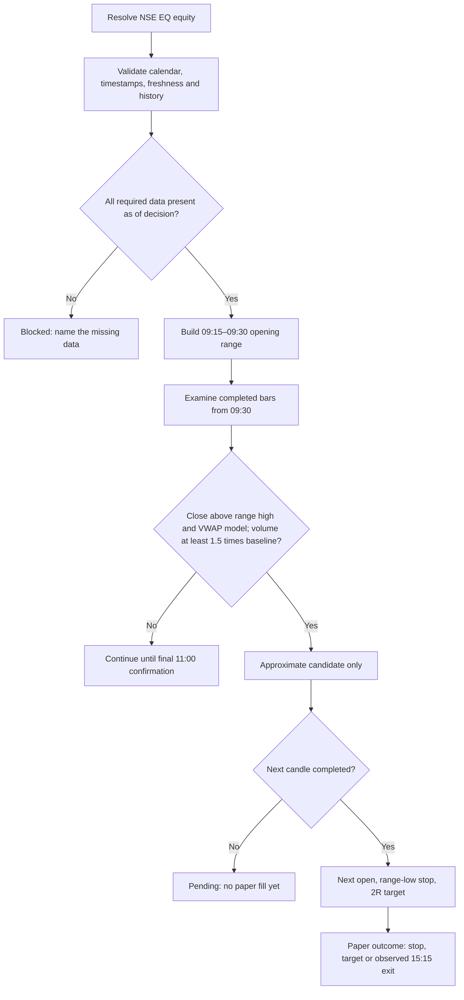
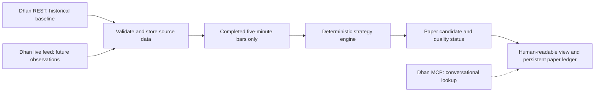

# Our NSE opening-range strategy

An explanation of the existing code and the implemented automatic simulated paper workflow. AWS production evaluates all 50 Nifty 50 constituents independently; see [the universe/scanner runbook](nifty50-paper.md). Updated 21 October 2026. This document does not start a monitor, connect a feed, or place an order. All example prices below are fictional.

## What can we do with what we have?

We can inspect structured historical prices, check opening ranges and volume patterns, validate data, and develop a read-only paper-analysis workflow. REST supplies full returned OHLCV arrays; Dhan MCP is useful for conversational queries but its tested historical tool exposes only a summary and five rows.

A REST session recorder and durable automatic paper worker are now implemented; see [the recorder runbook](session-recorder.md). Its full-session behavior still needs active-market validation. The current engine always returns `validSignal: false`, with exact strategy signal and trade set to null. When its data gates pass, it can separately report an **approximate candidate** and a **hypothetical trade**. That is the implemented behavior, not a claim that a profitable strategy has been established.

| Capability | Position today |
| --- | --- |
| Dhan REST credentials | Accepted for the historical requests we tested |
| Full returned candle arrays | Available through REST with epochs, prices and volume |
| Five-minute timestamp alignment | 144/144 sampled bars match start-aligned one-minute aggregation; explicit current vendor guarantee still unresolved |
| Complete regular session | Not obtained: tested data lacks 15:15, 15:20 and 15:25 start labels |
| Exact VWAP at each confirmation close | No verified source/input path implemented |
| Operational calendar and 20-session baseline | Must be verified and populated; test fixtures are not an operational calendar |
| REST session recorder and persistent candle store | Implemented; foreground command and quality reports in the recorder runbook |
| Market-hours scheduler and persistent paper loop | Implemented in the shared recorder process; strict default blocks exact execution; research explicitly opt-in |
| Notifications and WebSocket recorder | Not implemented |
| Order execution | Not implemented; the app is read-only |

## The strategy in plain language

Watch an NSE EQ-series cash equity. Let the first fifteen minutes establish a price range. After that, look for a completed five-minute candle that closes above both the range high and session VWAP, backed by unusually strong volume. Consider only the first qualifying long candidate. Model an entry at the next candle's open, a stop at the range low, and a target at twice the initial price risk.

The code currently substitutes an explicitly approximate VWAP model for the separate paper candidate. This approximation never qualifies the exact strategy.

## One trading day: all times are IST

Singapore is 2 hours 30 minutes ahead of IST.

| Event | India / IST | Singapore | What the engine does |
| --- | --- | --- | --- |
| Opening range | 09:15–09:30 | 11:45–12:00 | Use bars starting 09:15, 09:20 and 09:25 |
| First possible confirmation | 09:35 | 12:05 | Evaluate the completed 09:30–09:35 candle |
| First possible entry time | 09:35 | 12:05 | Hypothetical entry uses next bar's open; only report the fill after that bar completes at 09:40 |
| Last confirmation | 11:00 inclusive | 13:30 | Last eligible bar starts 10:55; a confirmation at 11:05 is too late |
| Time exit | 15:15 | 17:45 | Model the 15:15 open only once its candle completes at 15:20 |
| Regular session end | 15:30 | 18:00 | A full normal session has 75 five-minute slots |

The opening range is **[09:15, 09:30)**. The 09:30 candle is a possible breakout candle; it must not be included in the opening range.

## A fictional worked example

Assume every data gate has passed. The range high is ₹100 and range low is ₹96. The 09:30 candle closes at ₹101 at 09:35. The bar-based session VWAP approximation at that point is ₹100.40. The previous 20 trading sessions' median volume for the **09:30 start slot** is 10,000 shares; today's matching bar has 16,000 shares.

- Close above range high: ₹101 > ₹100.
- Close above approximate VWAP: ₹101 > ₹100.40.
- Relative volume: 16,000 / 10,000 = **1.60**, passing the minimum **1.50**.
- Hypothetical next-candle open: ₹101.50.
- Stop: ₹96. Initial price risk: ₹101.50 − ₹96 = **₹5.50 per share**.
- Target: ₹101.50 + 2 × ₹5.50 = **₹112.50**.

At 09:35 the next candle has only just begun. The current simulator waits until 09:40 before reporting its open as a paper fill. It does not pretend an order was executed at that earlier price. If the next open is at or below ₹96, reject the entry.

The example is an **approximate-model candidate**, not an exact-VWAP qualification or an order instruction. The automatic worker defaults explicitly to one simulated share and supports configured quantity and cost estimates. Unspecified fees/slippage leave net PnL unknown; taxes, impact and actual costs are not verified; 2R is a target distance, not an expected return or a guaranteed reward-to-risk outcome.

## Why the volume and VWAP details matter

**Volume:** compare the same five-minute start slot across the previous 20 verified trading sessions. Do not compare to the preceding bar, a daily average, or the opening bar on another day. A missing required session cannot be replaced by an older one. A zero median is undefined and blocks analysis.

**Approximate VWAP:** the implemented calculation is cumulative `sum(((high + low + close) / 3) × volume) / sum(volume)` across completed session bars through the candidate. It is a candle-based estimate, not an exact calculation from all trades.

**Exact strategy:** needs trustworthy session VWAP aligned to each confirmation candle's completion. A current quote's daily VWAP cannot be applied retrospectively to a past candle. Even a broker VWAP observation needs verified timing and alignment; the current engine has no exact-VWAP input path.

## What the missing final fifteen minutes do—and do not—prevent

For an evaluation at 10:00, future bars after 10:00 are not required. If the opening range, all completed bars through 10:00, and all required historical volume slots are present, the missing future session tail alone does not invalidate that morning snapshot. Today’s other data gates must still pass.

Likewise, prior sessions missing only their late-afternoon tail can still contain the required morning volume slots. Validate those exact slots and the calendar instead of assuming that either all history is useless or every session is complete.

For a full-day paper result, the gap matters. The observed last five-minute bar is labeled 15:10 and contains the minute labels 15:10–15:14. There is no observed 15:15 opening price for our time exit. If a hypothetical trade was still open, its final result is **unresolved**. Do not invent a closing fill. The stateless analysis can become blocked when expected bars are missing; the durable worker separately retains earlier positions and unknown exit outcomes; retain any earlier snapshots as observations, not as a completed backtest.

The automatic worker keeps managing existing paper positions even if new-entry calendar/baseline/VWAP gates are blocked. A stop or target observed earlier may provide an earlier paper outcome, but a missing-tail dataset still must not be presented as a complete session or a comprehensive performance record.

## How we can use it during a live market

The REST recorder and paper loop share the implemented market-hours service. The following operational sequence is automatic after reviewed deployment, but still needs a live-session trial. See [paper runbook](paper-trading.md).

1. **Before the session:** resolve a small watchlist; verify the exchange calendar; load the previous 20 trading sessions; check the matching morning volume slots. Check credential acceptance and data entitlement. Configure timestamp verification based on documented evidence, not merely the presence of a variable.
2. **Capture from before 09:15:** start a single read-only collector and retain source and receive timestamps. For REST, cover slightly before the desired lower bound and filter locally: our tested exact 09:15 request excluded the 09:15 row. The recorder implements the padded fetch; the original single-session MCP tool still uses its existing exact lower bound.
3. **Verify the live path:** test REST freshness after candle completion. If it lags or omits expected bars, label the snapshot stale/blocked. Dhan documents a WebSocket feed with trade time, price, volume and average trade price, but our app does not yet implement or validate that recorder. A live feed could capture future tails; it cannot repair missing historical observations automatically. Reconnect gaps must remain visible.
4. **Evaluate after each completion:** use [start, end) intervals; exclude incomplete bars; use a small settlement delay chosen from observed delivery lag. Recheck source timestamps and completeness before every evaluation. Keep calculations in code; use MCP or an assistant to explain results.
5. **Record paper events:** store the data snapshot, reason for candidate/rejection, approximation label, missing-data state, and observed simulated outcome. Deduplicate evaluations so one candidate is not counted repeatedly. Candle state and the durable decision/trade ledger are implemented. Notifications are not configured; the assistant can inspect/export results and update Notion after a user request.
6. **At 15:15:** record an exit only from an observed, timestamp-aligned source. The current candle simulator reports that open after 15:20. If unavailable, mark the outcome unresolved and raise a data-quality event.

Morning paper monitoring can be useful before full-day replay is solved, but only after these live inputs and operational gates are validated. It does not justify enabling order execution. Dhan's MCP also offers trading actions; those are outside this app's read-only strategy workflow.

## Practical next steps

**First:** run the implemented REST recorder with its padded lower boundary and quality reports; establish the operational calendar and exact-slot history; validate an active session through its close. WebSocket capture and a dedicated live dashboard remain future work.

**Then:** review the implemented persistent ledger and transparent unknown outcomes using the synthetic full-session/restart tests. After reviewed deployment, inspect observed paper sessions and failures before judging results. Strict gates remain closed; approximate research requires explicit assumptions.

**Separately:** obtain vendor confirmation of timestamp semantics and investigate the historical tail omission. To qualify the exact strategy, implement a verified candle-aligned VWAP source and update the engine's contract and tests. Full OHLCV alone cannot remove that limitation.

## References and evidence

- [Existing strategy implementation](../src/analysis.ts), [data adapter](../src/dhan.ts) and [README](../README.md).
- Local diagnostic evidence: `.local/dhan-mcp/VALIDATION.md` and `timestamp-aggregation-evidence.json` (gitignored; contains no copied credentials).
- [Dhan historical API](https://dhanhq.co/docs/v2/historical-data/): structured epochs and OHLCV arrays; current text does not explicitly guarantee start/end labels.
- [Dhan market quotes](https://dhanhq.co/docs/v2/market-quote/): snapshot fields including daily average price. A snapshot is not historical candle-aligned VWAP.
- [Dhan live feed](https://dhanhq.co/docs/v2/live-market-feed/): proposed future capture path. Protocol capabilities are documented; this project's live feed behavior remains untested.

All observations above describe the tested samples, not a universal claim about every Dhan instrument or session. No live monitor or deployment was started by writing this guide.
